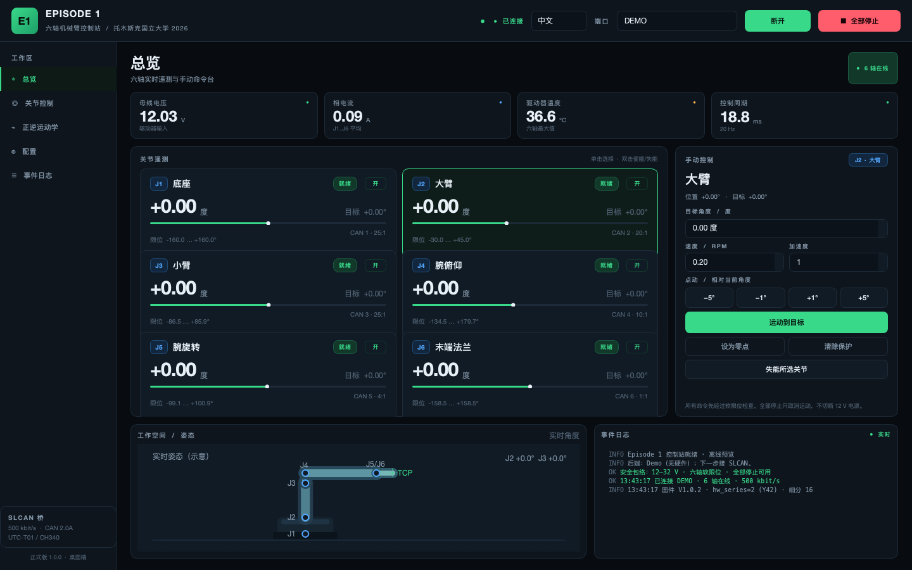

# Robot 2026 — Episode 1 六轴机械臂

本目录只包含六轴机械臂：ZDT X42S_V1.0 + 17HS3401S-HG25 + UTC-T01 SLCAN，
树莓派/笔记本通过 USB-CAN 控制。

```text
robot-2026/
├── arm/                     # 本机在用的控制程序与配置
│   ├── armctl.py            # scan/info/zero/jog/move/move-all/stop/set-id
│   ├── track_angle.py       # 失能后手搬，实时显示输出轴角度
│   ├── set_j2_zero.py       # 把 J2 当前姿态设为 0 并写限位
│   ├── config/joints.json   # 实测减速比与软限位
│   ├── tests/               # 离线单测
│   ├── README.zh.md         # 中文操作手册
│   └── README.ru.md         # 俄语说明
├── app/                     # 桌面上位机（PySide6，中/英/俄，macOS/Windows）
├── robot-arm/               # GitHub-ready 发布包
├── kinematics/              # FK/IK、机构简图、STEP 三视图、导师报告
└── docs/                    # 验证记录、Cangaroo 调研、极限表、报告
```

## 当前状态

- CAN：`/dev/cu.usbmodem1101`（macOS），500 kbit/s，6 个 ID 全部在线。
- 驱动器：板上丝印 `X42S_V1.0`，版本帧 `V1.0.2 / hw_series=2`，程序显示 `Y42`。
  **不能写成 Emm42 V5；未刷固件。**
- 减速比：`J1..J6 = 25/20/25/10/4/1`（上游官方值，J5 实测 220° 已反证）。
- 软限位与零点：

| 关节 | 减速比 | 软限位 / ° | 零点 |
|---|---:|---|---|
| J1 | 25 | −160…+160 | 中位 |
| J2 | 20 | −30…+45 | 负限位上方约 +50° |
| J3 | 25 | −86.5…+85.9 | 中位 |
| J4 | 10 | −134.5…+179.7 | 中位 |
| J5 | 4 | −99.1…+100.9 | 中位 |
| J6 | 1 | −158.5…+158.5 | 中位 |

- 已验证：J2 +1°/−1°，六轴同步 ±1°，J6 +5° 及返回。
- 当前状态文件：六轴 `angle=0.000°`、`zeroed`、`valid=True`。
- 离线测试：`robot-arm` 14 项全部通过。

## 快速开始（macOS）

```bash
cd ~/robot-2026/arm
source .venv/bin/activate

python armctl.py ports
python armctl.py scan --iface slcan --channel /dev/cu.usbmodem1101 --start 1 --end 8
python armctl.py info  --iface slcan --channel /dev/cu.usbmodem1101 --id 1
python armctl.py state
```

单轴小角度：

```bash
python armctl.py move --iface slcan --channel /dev/cu.usbmodem1101 \
  --id 2 --deg 1 --rpm 0.5 --wait-timeout 20
```

六轴同步：

```bash
python armctl.py move-all --iface slcan --channel /dev/cu.usbmodem1101 \
  --deg "1,1,1,1,1,1" --rpm 1.0 --wait-timeout 40
```

> J6 减速比为 1，`--rpm` 必须 ≥ 1.0；小于 1 时会被代码拒绝，否则驱动器收到
> 0 转速会返回 `0xEE 命令参数错误`。


## 桌面上位机（中 / 英 / 俄）



- 源码与说明：[app/README.zh.md](app/README.zh.md)
- 自适应布局：高度低于 920 px 自动紧凑模式，窗口最小 1180×760；内容过多时可滚动
- 浅色 / 深色双主题：顶部“夜间 / 日间”一键切换，记住上次选择；默认浅色
- 实时姿态图：零位与 CAD 一致，随 J1–J6 软件角度和 Move/Jog 指令变化
- 侧边栏：关节控制（六轴大面板）、正逆运动学、配置（只读限位/减速比表）、事件日志（复制/导出）
- macOS 应用：[Episode1-macOS-arm64.zip](app/dist/Episode1-macOS-arm64.zip)（Apple Silicon，已本机截图验证）
- Windows 应用：[Episode1-Windows-x64.zip](app/dist/Episode1-Windows-x64.zip)（x64，GitHub Actions 构建，并已通过 Windows CI 启动/截图 smoke test；未接真实 CAN 硬件）
- 三语截图：[中文](app/docs/ui_preview_zh.png)、[English](app/docs/ui_preview_en.png)、[Русский](app/docs/ui_preview_ru.png)
- 深色主题：[截图](app/docs/ui_preview_dark.png)
- FK/IK 工作台：[截图](app/docs/kinematics_preview_zh.png)
- 构建脚本：[build_macos.sh](app/build_macos.sh)、[build_windows.ps1](app/build_windows.ps1)

macOS 打开 `.app` 若被 Gatekeeper 拦截：右键 → 打开；当前是 ad-hoc 签名，未公证。
Windows 解压后运行 `Episode1.exe`；首次运行 SmartScreen 可能提示，选“更多信息 → 仍要运行”。

## 运动学（FK / IK）

导师布置的正/逆运动学任务在 [kinematics/](kinematics)：

- 官方 DH 参数、正解、几何雅可比、阻尼最小二乘逆解；
- 9 项离线测试；
- 机构简图：[kinematic_diagram.png](kinematics/docs/kinematic_diagram.png)；
- STEP 三视图：[three_views.png](kinematics/docs/three_views.png)；
- 详细公式与标定步骤：[KINEMATICS.md](kinematics/docs/KINEMATICS.md)；
- 俄语报告：[advisor_report_ru.md](kinematics/docs/advisor_report_ru.md)。

注意：`armctl.py state` 的角度不是 DH 角 `q`，也不是电机角 `m`；上实机前必须先按
`KINEMATICS.md` 第 7 节标定零点和方向。

## 安全红线

1. 供电 12–32 V，**严禁 48 V**；上电前万用表确认电压和极性。
2. CAN 只接 `CAN_H` / `CAN_L`，不接 GND；总线两端 120 Ω。
3. 不刷固件，保持现有 Emm42 兼容固件。
4. `disable` 会让关节失去保持力，必须托住；`stop` 不切断电源。
5. 做大角度动作前把底座夹紧；第一次动作手放在电源开关上。


详细记录见 [docs/validation.md](docs/validation.md) 和
[docs/KNOWN_ISSUES.md](docs/KNOWN_ISSUES.md)。

## 发布包

- 目录：[robot-arm/](robot-arm)
- 压缩包：[robot-arm-v1.0.2.zip](robot-arm-v1.0.2.zip)

包内默认配置是 generic 6-DOF、限位 `null`；使用实测配置：

```bash
cp config/profiles/episode1_measured.json config/joints.json
```
