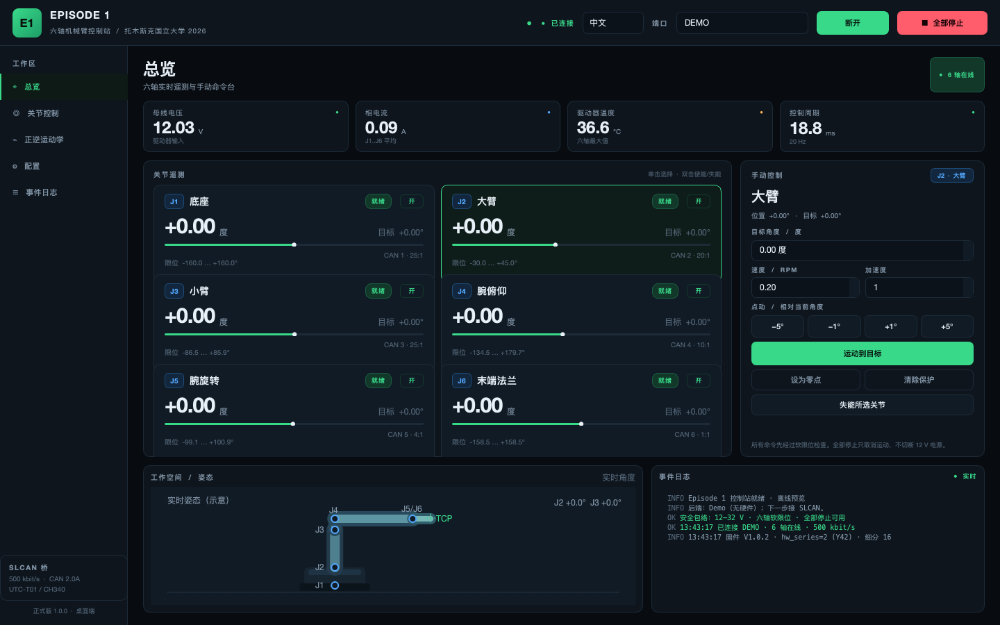
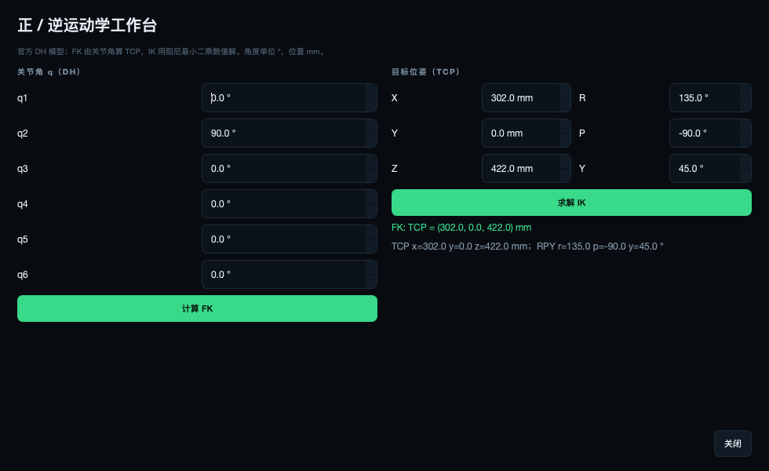

# Episode 1 · Arm Control Station

六轴机械臂桌面上位机。中 / 英 / 俄三语，支持 Demo 演示和真实 SLCAN
（UTC-T01 / CH340）控制，复用 `../arm/armctl.py` 的运动、软限位和状态逻辑。



## 已实现

- 三语切换：中文 / English / Русский，重启后记住上次语言
- Demo 模式：无硬件也能看完整界面、动效和日志
- 真实 SLCAN 后端：扫描 ID 1–6、状态轮询、使能/失能、点动、绝对角度、六轴同步、停止、清保护、设零点
- 安全约束：12–32 V 检查、软限位、未 zero 拒绝运动、六轴缺一不连接
- 六轴状态卡、电压/电流/温度/周期、侧视示意图、事件日志
- FK/IK 工作台：官方 DH 模型，FK 算 TCP，数值 IK 反解关节角（离线，不直接下发运动）
- macOS `.app` 已构建；Windows `.exe` 提供 PowerShell 脚本 + GitHub Actions

## 运行（源码）

```bash
cd ~/robot-2026/app
python3 -m venv .venv
source .venv/bin/activate          # Windows: .venv\Scripts\activate
pip install -r requirements.txt
python main.py --demo
```

macOS 没有系统 PySide6 时，`run.sh` 会自动使用 FreeCAD 自带的 Python：

```bash
./run.sh --demo
```

生成三语预览图：

```bash
QT_QPA_PLATFORM=offscreen ./run.sh --screenshot docs/ui_preview_zh.png --size 1440x900
EPISODE1_LANG=en QT_QPA_PLATFORM=offscreen ./run.sh --screenshot docs/ui_preview_en.png
EPISODE1_LANG=ru QT_QPA_PLATFORM=offscreen ./run.sh --screenshot docs/ui_preview_ru.png
```

## 连接真实机械臂

1. 确认驱动器 12–32 V、CAN_H/CAN_L、500 kbit/s、120 Ω 终端电阻。
2. 插 UTC-T01，先运行 `python ../arm/armctl.py ports` 确认串口（每次上电可能变化）。
3. 在顶部 `PORT` 填 `/dev/cu.usbmodemXXXX`（Windows 为 `COMx`），点“连接”。
4. 后端会扫描 ID 1–6；**缺一个就拒绝连接**，不会带病发运动命令。
5. 第一次动作：选 J2，`+1°`，`0.05 RPM`，手放在电源开关上。

> 当前 J1 有未解决的堵转/电压跌落问题，见 `../docs/KNOWN_ISSUES.md`。
> 软件 STOP 不切断 12 V；没有硬件急停回路。

## 打包

### macOS

```bash
cd ~/robot-2026/app
./build_macos.sh
# 产物：dist/Episode1.app
#       dist/Episode1-macOS-arm64.zip
```

已在本机生成 `dist/Episode1.app`（Apple Silicon，约 104 MB）。
当前是 ad-hoc 签名；发给别人的 Mac 需要在“隐私与安全性”里放行，正式发布需
Developer ID + notarytool。

### Windows

macOS 不能交叉编译 Windows PE，所以 `.exe` 必须在 Windows 上生成：

```powershell
cd app
.\build_windows.ps1
# 产物：dist\Episode1\Episode1.exe
#       dist\Episode1-Windows-x64.zip
```

或者把仓库推到 GitHub，手动运行 `.github/workflows/build-windows.yml`，
下载 artifact `Episode1-Windows-x64`。macOS 对应 workflow 为
`.github/workflows/build-macos.yml`。

## 代码结构

```text
app/
├── main.py                       # 入口：--demo / --screenshot
├── episode1_app/
│   ├── i18n.py                   # zh/en/ru 文案与切换
│   ├── models.py                 # JointState / Snapshot
│   ├── backend.py                # DemoBackend / SlcanBackend
│   ├── theme.py                  # 深色工业风
│   ├── widgets.py                # JointCard / MetricCard / ArmCanvas / LogView
│   └── window.py                 # 主窗口、语言切换、命令面板
├── assets/icon.png|ico|icns      # 应用图标
├── build_macos.sh
├── build_windows.ps1
├── requirements.txt
└── docs/ui_preview_*.png
```

## FK/IK

顶部导航 `正 / 逆运动学` 打开工作台。FK 输入 q（度），输出 TCP 的 x/y/z 与 RPY；
IK 输入目标 x/y/z + RPY，用带关节限位的阻尼最小二乘求解，结果只回填到输入框，
**不会自动下发到机械臂**。默认 q 是官方 home `[0,90,0,0,0,0]`，TCP `[302,0,422]` mm。



## 限制

- 侧视示意图是示意，不是由 FK 实时驱动。
- IK 结果需要人工确认软限位/碰撞后再下发；当前 UI 不自动执行。
- Windows `.exe` 未在本机生成（无 Windows/Wine）；脚本和 CI 已准备好。
- 未做代码签名/公证；对外分发前需处理 Gatekeeper / SmartScreen。
